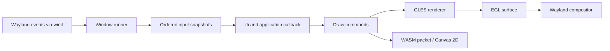

# Architecture and Window Lifecycle

Status: describes the initial implementation, with future work explicitly identified.

## Module boundaries

**EdgeStretch overscroll physics** – Implements AOSP `EdgeEffect.TYPE_STRETCH` with pull, reverse‑pull, damping, recoil, and fling‑absorb mechanics as defined in `codes/libs/ui/libbhoo/src/scroll.rs`.

**Frame::cancel_pointer_input** – Handles `ACTION_CANCEL` to let ripples finish their 375 ms fade while cancelling pending <150 ms tap ripples.

**GPU‑scaled CollapsingToolbarLayout** – Supports dynamic title scaling via GPU transforms in the renderer.

**Android XML runtime + importer pipeline** – Integrated importer parses Android XML layouts into Bhoo widget trees (`android_xml.rs`).

**WebGL/WASM + WebXDC demos** – Catalog, Contacts, Android 13 Launcher/System UI demos run as Rust/WASM previews.

**Wayland/GLES native capture harness** – Captures framebuffer for performance and parity validation.

| Module | Responsibility | Does not own |
| --- | --- | --- |
| `src/lib.rs` | Theme, geometry, widget interaction, vertical layout, draw commands | Native windows or graphics contexts |
| `src/platform/window.rs` | Wayland event loop, EGL setup, input translation, redraw and presentation | Application business state |
| `src/platform/gles/mod.rs` | GLES resources, glyph rasterization, geometry generation, drawing and framebuffer capture | Native input or widget state |
| `examples/launcher.rs` | Demonstration content, click counter, smoke-test mode | Desktop application discovery or launching |

| Module | Responsibility | Does not own |
| --- | --- | --- |
| `src/lib.rs` | Theme, geometry, widget interaction, vertical layout, draw commands | Native windows or graphics contexts |
| `src/platform/window.rs` | Wayland event loop, EGL setup, input translation, redraw and presentation | Application business state |
| `src/platform/gles/mod.rs` | GLES resources, glyph rasterization, geometry generation, drawing and framebuffer capture | Native input or widget state |
| `examples/launcher.rs` | Demonstration content, click counter, smoke-test mode | Desktop application discovery or launching |

Source paths are relative to `codes/libs/ui/libbhoo`. The `wayland` Cargo feature enables the optional window and renderer dependencies. Without it, the core can be built and tested without a display or graphics stack. The current public boundary permits another backend to consume `DrawCommand`; the browser explorer now consumes it through a Rust/WASM packet and Canvas 2D host.

## Application API

`window::run(WindowOptions, callback)` runs on the main thread and owns one window. The callback receives `&mut Frame` and returns a `FrameAction`:

| Action | Behavior after rendering the current frame |
| --- | --- |
| `Wait` | Wait for input or window events; queued input still schedules another frame |
| `Redraw` | Request another frame, suitable for ongoing animation |
| `Exit` | Optionally capture the framebuffer, swap buffers, then exit the loop |

`WindowOptions` provides the title, initial logical content size, optional font path, optional capture path, and motion preference. Defaults are a 420×360 window titled Bhoo with full motion. The examples override the title and size.

Application state lives in the callback's captured values. Widget IDs are caller-supplied `u64` values and must be unique and stable. The current context retains pointer capture, not an application data model or persistent widget tree.

For headless/core integrations, `Ui::frame` returns an owned command vector. `Ui::frame_into` clears and reuses a caller-provided vector's capacity. The window runner uses the latter.

## Startup and shutdown

1. Reject zero initial dimensions and create a Wayland-only winit event loop with `ControlFlow::Wait`.
2. On resume, resolve the font path and create a normal Wayland toplevel.
3. Select an EGL configuration supporting GLES 3, eight alpha bits, and no requested depth or stencil buffer; prefer fewer multisamples.
4. Request a GLES 3.0 context, create the window surface, make the context current, and request swap interval one.
5. Load GL entry points, compile/link shaders, initialize renderer resources, and request the first redraw.
6. On suspension, release graphics resources and cancel pending pointer input. Resume recreates graphics while retaining the application callback and UI context.
7. On normal loop exit, release renderer resources before the EGL surface, context, and native window.

The backend has no X11 or desktop-OpenGL fallback. EGL may return a GLES version newer than 3.0. Diagnostic output reports the actual version and renderer string.

Most initialization and rendering errors propagate from `run`. Internal assumptions such as a nonempty configuration iterator still use `expect`; converting these assumptions into explicit diagnostics is future hardening. Context loss currently exits through the error path rather than recovering transparently.

## Frame sequence

On `RedrawRequested`, the runner skips zero-sized windows, converts the physical window size to logical units, and consumes at most one queued input snapshot. It builds the UI, translates commands to geometry, renders, calls `pre_present_notify`, and swaps the EGL surface.

The current content area has a fixed 24 logical pixel inset and 12 pixel vertical gap. Labels allocate 24 pixels of height; buttons allocate 36. This is a prototype vertical layout, not a flex/grid engine. Heights are clamped to the available space.

Button hit testing uses bounds calculated during the current build. CUI's previous-frame hit-testing strategy has not been adopted. Overlap resolution and arbitrary positioned widgets need a richer interaction design before they are introduced.

`Exit` submits the last frame but does not guarantee the compositor displayed it before the process closed. The screenshot path captures the application's framebuffer, not a compositor screenshot.

## Input ordering and capture

Cursor positions are converted from physical coordinates to logical coordinates. Left-button press and release edges enter a `VecDeque<Input>` with their pointer positions. Consecutive motion-only snapshots coalesce, while button edges retain their order. Processing one snapshot per frame prevents a fast press/release pair from being collapsed into a lost click.

A button captures an uncaptured press inside its bounds. A click requires release inside the same stable button ID. Releasing outside does not click. Release clears capture even when the previously active widget was removed.

Pointer leave, focus loss, and scale changes clear queued snapshots and enqueue cancellation; suspension also cancels input. This intentionally cancels a drag when leaving the window. Supporting drags outside the surface will require a revised capture policy.

Escape and the window close event exit immediately. Tab/Shift+Tab, Enter/Space, arrows, Home/End and wheel input are now translated into the core. The [implementation record](implementation-progress.md) specifies which controls consume them. Text input, IME and touch remain open. The queue has no explicit size limit, and one-snapshot-per-frame processing can add latency during event bursts; instrument this before adding high-rate interaction.

## Scaling and scheduling

Widgets use logical pixels; the viewport and EGL surface use physical pixels. Resize events resize nonzero surfaces. Scale changes request a redraw and invalidate the renderer's scale-specific glyph cache on its next render. Automated coverage currently includes integer scales 1 and 2, not fractional scale or moving between real monitors.

Normal UI frames do not continuously request redraws. The runner also checks active core effects and pending input; tooltip deadlines use the earliest `WaitUntil` wakeup. The callback can explicitly return `Redraw`. Background application updates still need wakeup integration. Swap interval one and Wayland redraw notifications are the initial pacing mechanism. There is no independent fallback clock or measured frame-pacing guarantee yet.

## Wayland launcher integration

The current example is a regular application window. A desktop launcher may need layer-shell, monitor selection, exclusive keyboard focus, and compositor-specific activation behavior. Select those protocols after defining the launcher UX. Keep that integration outside widget and renderer code; a working toplevel is not evidence that desktop-shell behavior is complete.

## Effect and visibility ownership

UI-owned springs, duration tracks and visible-only phase clocks share the bounded motion store. Radial ink has a separate bounded owner/part store, pruned every frame. Loading geometry is immutable generated data; per-instance `LoadingState` retains only elapsed time and visibility generation. No runtime JVM or asset animation framework is used.

The native runner handles primary touch events and cancellation, and routes Escape through active overlays/tooltips/capture before its window-close shortcut. Native occlusion and browser document/tab hiding cancel transient press ink, discard queued pointer edges and reconcile loading clocks on resume. Timed overlays keep logical dismissal and focus restoration independent from presentation exit. See [the effect implementation](effects-implementation.md).
