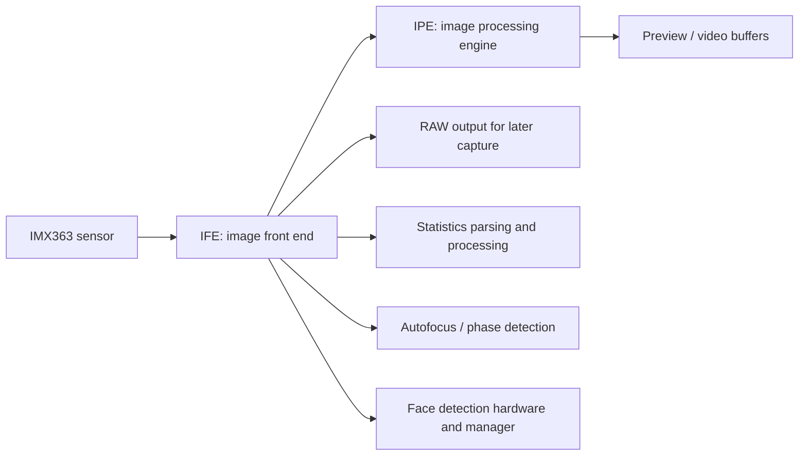

# Original Xiaomi Poco F1 camera pipeline

Investigated on 2026-10-20 on the build host using the owner's archived MIUI ROM,
REA 6.7.0/Ghidra 12.1.4 and bounded binary decoders. This is static evidence
from that ROM, not a live trace of Android or of the current NixOS phone.

## What was recovered

- All **45 use cases / 115 pipeline definitions** from the original
  `/vendor/lib/camera/titan17x_usecases.bin`.
- All **36 compiled pipelines** in `com.qti.chi.override.so`'s `UsecaseZSL`,
  including Xiaomi-specific variants, node/plugin bindings, port links,
  input/output targets and the advanced-feature-to-pipeline index map.
- REA decompilation of use-case construction, feature selection, ZSL, MFNR,
  HDR and SuperNight pipeline selection.
- Sensor-specific Sunny Chromatix processing-stage names and the previously
  verified CC13 colour matrix.

The complete named inventory is in [camera-pipeline-inventory.md](camera-pipeline-inventory.md).
This establishes the architecture and concrete static paths. It does **not**
recover every proprietary algorithm, ISP microcode, tuning trigger, dynamic
node modification or the exact path selected for an individual stock photo.

## Application and control path

```text
MiuiCamera.apk
  → Android Camera2 capture requests + Qualcomm/Xiaomi vendor tags
  → Android camera framework/service and camera HAL interface
  → camera.qcom.so (Qualcomm CamX)
  ↔ com.qti.chi.override.so (use-case / feature / pipeline selection)
  → camera drivers and sensor / ISP / lens / flash control
```

The APK's inspected methods delegate exposure, white balance, noise reduction,
saturation and sharpness to Camera2/vendor controls. They do not implement the
whole image pipeline. The HAL/framework relationship is described by
[AOSP's Camera HAL documentation](https://source.android.com/docs/core/camera/camera3).
The original ROM is Android 10-era; modern AIDL material on that page must not
be mistaken for this ROM's interface.

The Snapdragon 845 contains the Spectra 280 ISP; Qualcomm describes hardware
support for multi-frame noise reduction and high-rate capture in its
[845 announcement](https://www.qualcomm.com/news/releases/2017/12/qualcomm-snapdragon-845-mobile-platform-introduces-new-innovative).
Those platform capabilities alone do not prove per-photo feature activation.
The graphs and feature-selection code below provide device-ROM evidence.

## Real-time preview and RAW collection

The compiled `ZSLPreviewRaw` pipeline, index 25 / advanced type 5, contains:



The named buffer links establish sensor→IFE, IFE full/DS4/DS16→IPE, and separate
RAW output. Statistics include AWB, HDR exposure, histograms, row sums and
tintless grids. The graph's stats nodes load exposure (`com.qti.stats.aec`),
white-balance, flicker detection, autofocus and PDAF plugins. These results feed
control/tuning decisions through metadata; metadata feedback is not represented
as a direct pixel-buffer edge in the graph.

`MiuiZSLPreviewRaw`, index 24 / advanced type 27, adds an actual display branch:

```text
IPE → ArcSoft skinbeautifier → Xiaomi mibokeh → preview
```

It also retains separate video and RAW targets. Its stats node specifically
loads `com.qti.stats.awbwrapper`. The beauty/bokeh nodes can be present while
an effect is disabled or bypassed; graph presence is not evidence that ordinary
rear-camera photos are beautified.

## Full-resolution saved photos

The ordinary compiled `ZSLSnapshotJpeg`, index 1 / advanced type 0, connects:

```text
RAW input → BPS → IPE → JPEG encoders → JPEG aggregator → snapshot buffer
```

BPS is the Bayer processing stage. Its full/DS4/DS16/DS64 outputs feed IPE.
The graph has two JPEG instances feeding the aggregator. Their usual main/
thumbnail interpretation is plausible, but their exact stream roles were not
independently traced in this investigation.

The Xiaomi variant `MiuiZSLSnapshotJpeg`, index 0 / advanced type 28, connects:

```text
RAW → BPS → IPE
    → ArcSoft skinbeautifier
    → Xiaomi mibokeh
    → Qualcomm GPU node
    → watermark
    → JPEG → JPEG aggregator → saved-photo buffer
```

The exact plugin identifiers are `com.arcsoft.node.skinbeautifier`,
`com.xiaomi.node.mibokeh`, `com.qti.node.gpu` and `com.qti.node.watermark`.
The GPU node carries property 12 with value `32`; this report does not infer
its precise operation from that number alone. The YUV-to-JPEG pipeline
`InternalZSLYuv2Jpeg`, index 7 / advanced type 2, starts from processed YUV,
passes through IPE and this same custom-node chain before encoding.

Thus preview and saved photos can use different processing paths, and the
snapshot path can reprocess retained RAW instead of simply saving the preview.

## Multi-frame branches

### Qualcomm multi-frame noise reduction

`FeatureMfnr::GetRequiredPipelines` selects the conversion/encoding path and
four explicit processing stages, plus a real-time pipeline when applicable:

| Advanced type | Compiled index | Pipeline |
| --- | --- | --- |
| 7 | 19 | `MfnrPrefilter` |
| 9 | 32 | `MfnrBlend` |
| 8 | 16 | `MfnrScale` |
| 10 | 28 | `MfnrPostFilter` |
| 2 | 7 | `InternalZSLYuv2Jpeg` (normal branch) |

The decoded graphs include BPS/IPE processing, full and downscaled reference
buffers, and `com.qti.node.swregistration` in blending/post-filter paths.
This is evidence of alignment and multi-frame processing infrastructure, beyond
a single denoising slider. The required-pipeline array is not by itself a
frame-by-frame execution schedule; scheduling/iteration details remain untraced.

The inspected `GetMFNRTotalFramesByGain` reads `AECFrameControl` metadata and
returns five or eight frames along its recovered branches, with eight as its
initial fallback. This describes that helper only. It does not prove every
photo uses five/eight frames, nor that its AEC gain equals libcamera's sensor
analogue-gain number.

### HDR

`FeatureHDR::GetRequiredPipelines` selects Bayer-to-YUV, a merge pipeline,
YUV-to-JPEG and, when applicable, preview. Advanced type 4 maps to compiled
index 21, `Merge3YuvCustomTo1Yuv`, whose custom node is
**`com.arcsoft.node.hdr.so`**.

Despite the name containing “3”, the compiled definition exposes four YUV
input target entries. This is interface capacity, not proof of the number of
exposures used. Exposure bracketing, reference selection, alignment and merge
mathematics have not been recovered here.

### Night / low light

`FeatureSuperNight::GetRequiredPipelines` uses a similar conversion/merge/
encoding arrangement, with advanced type 33 mapping to compiled index 31,
`SuperNightYuv`. Its plugin is **`com.arcsoft.node.superlowlight.so`** and its
definition exposes eight YUV input target entries. Actual frame counts and
activation thresholds remain conditional and unverified at runtime.

The compiled catalog also contains HHT, super-resolution, clear-shot, scene
analysis and portrait variants. Their names/graphs are recorded in the
inventory; their internal algorithms were not reverse-engineered in this pass.

## Processing within IFE, BPS and IPE

The Sunny tuning container explicitly names these groups. This table groups
functions for explanation; **it does not assert exact internal execution order
or that every listed module is enabled**.

| Group | Original tuning symbols | What the group concerns |
| --- | --- | --- |
| Bayer baseline and defects | `pedestal13_*`, `linearization33_ife`, `linearization34_bps`, `bls12_*`, `pdpc*`, `bpcbcc50_ife`, `gic30_bps` | Sensor baseline/linearity, defects and green-channel processing |
| Lens / spatial correction | `lsc34_ife`, `lsc34_bps`, `tintless20_sw`, `cac22_ipe` | Lens shading, tint variation and chromatic aberration |
| RAW noise processing | `abf34_ife`, `abf40_bps`, `hnr10_bps` | Bayer-domain filtering/noise-related tuning |
| Demosaic and colour | `demosaic36_*`, `cc12_ife`, `cc13_bps`, `cc13_ipe`, `cst12_*`, `cv12_ipe` | Reconstruct colour and transform colour spaces |
| Brightness / tone | `gtm10_*`, `ltm13_ipe`, `gamma16_*`, `gamma15_ipe`, `tmc10_sw` | Global/local tone mapping and gamma |
| Motion / denoising | `lrme10_ipe`, `ica10_ipe_module1/2`, `anr10_ipe`, `tf10_ipe`, `mf10_sw` | Motion/geometry and spatial/temporal processing |
| Detail / output | `asf30_ipe`, `upscale20_ipe`, `cs20_ipe`, `sce11_ipe` | Detail, scaling and colour/chroma adjustments |

The binary also contains exposure metering/convergence, AWB reference-point,
flash, face and touch tuning. Our previous work extracted only one constant
CC13 branch, not this complete collection or its selection algorithms.

## Which path is actually selected?

REA recovered `AdvancedCameraUsecase::SelectFeatures`: it intersects an
operation-mode feature mask with the extension module's allowed-feature mask,
then conditionally constructs ZSL, MFNR, HDR, SuperNight and other features.
`BuildUsecase` collects/deduplicates their required pipelines and copies the
selected descriptors. `GetPipelineDescriptorFromUsecase` maps advanced types
to compiled array indices. The default normal ZSL branch requests types 0 and
5; other operation modes can request MIUI types 28 and 27 instead.

Consequently, there is **a family of conditional pipelines**, not one universal
linear chain. A complete per-photo answer still requires the selected camera,
operation mode, vendor tags, allowed-feature settings, runtime metadata and
node bypass/enables. This investigation did not boot Android or replace NixOS.

A significant cross-check: the generic Titan container's HDR merge node binds
`com.qti.node.memcpy`, whereas the compiled Xiaomi graph binds ArcSoft HDR.
Reporting the generic graph alone as the actual Xiaomi processing would be
wrong. Three generic definitions also contain repeated node records or missing
face-detector endpoints; the decoder preserves those inconsistencies as warnings.
The selected compiled 36-pipeline graph resolved all its buffer-link endpoints.

## Implications for Spectre Camera

Our application uses the libcamera simple pipeline and CPU software
ISP. Its black-level correction, generic AWB, one Sunny colour matrix and gamma
represent only part of the above system. It does not currently reproduce the
stock factory AWB/lens-shading application, calibrated focus, BPS/IPE hardware
processing, motion-aligned multi-frame noise reduction, ArcSoft HDR/night merge,
or Xiaomi's complete tone/detail pipeline.

Update 2026-10-21: Spectre Camera 0.4.0 adds its own measured-noise RAW filter,
motion-gated burst processing and chroma filters. See [noise reduction](camera-noise.md).
These additions supersede the lack of software noise reduction above; they do
not reproduce the proprietary BPS/IPE implementation.

Reconstructing a graph does not make these Android/Qualcomm/ArcSoft components
usable as libcamera algorithms. The original CHI library depends on Android
camera metadata, hardware, graphics and system libraries. Matching buffers,
metadata and driver interfaces—and implementing or adapting the algorithms—is
separate work. We can use the recovered calibration and verified behavior as
porting evidence, while testing each change on the current sensor.

## Can we execute the original Xiaomi blobs?

Read-only inspection on 2026-10-20 distinguishes three reuse cases:

| Component | Reuse on the current system |
| --- | --- |
| Sunny sensor tuning / calibration | Decode and adapt supported parameters. The application already uses a decoded Sunny colour matrix; the complete Chromatix file is not a libcamera tuning format. |
| CamX HAL and CHI graph library | Not directly loadable into our libcamera backend. The inspected copies are ARM32 Android libraries, with Android camera metadata, graphics/system dependencies and vendor driver contracts. |
| ArcSoft processing engines | The HDR engine now runs through the [camera-specific helper](camera-xiaomi-compat.md), tested on synthetic full-resolution inputs. Real-photo quality, low-light HDR and SuperNight are not validated. |

The original HDR CHI node links `libarcsoft_high_dynamic_range.so` and
`libarcsoft_low_light_hdr.so`; the SuperNight node links
`libarcsoft_supernight.so`. All three engines are ARM32 and declare only
`libmpbase.so`, `liblog.so`, `libdl.so`, `libc.so` and `libm.so` as direct
dependencies. `libmpbase.so` itself declares only `libc.so`. The engine exports
include `ARC_HDR_Init/PreProcess/Process`, `ARC_LLHDR_Init/Process` and
`ARC_SN_Init/Process`. These are actual original libraries, not reimplementations.

This led to an Android/Bionic-compatible 32-bit HDR helper. Its ABI and buffer
processing were recovered and tested on the phone; see the
[implementation and validation report](camera-xiaomi-compat.md). Connecting it
to real libcamera exposure brackets and validating photo quality remain separate
work. The current Qt application does not invoke it yet.
Direct ELF dependencies do not prove that an engine is entirely CPU-only or
independent of additional runtime services. These YUV postprocessing engines
also do not replace the missing upstream RAW ISP tuning, AWB, focus or lens
shading, and cannot guarantee stock quality from our current input images.

Running the complete stock pipeline additionally requires compatible vendor
kernel interfaces for the Qualcomm ISP. A Halium/libhybris-style adaptation is
a different system-integration project; a container or Bionic loader alone does
not provide those interfaces. [libhybris](https://github.com/libhybris/libhybris)
provides the general Bionic-on-glibc compatibility approach, not proof that this
particular camera stack works on our kernel.

The files were extracted read-only from the existing vendor image into the
server research `original/vendor/` directory. Headers, dynamic dependencies,
symbols and hashes are preserved in
`evidence/stock-blob-reuse-dependencies.json`. No blobs were installed on the
phone during this inspection.

| Engine / helper | SHA-256 |
| --- | --- |
| `libarcsoft_high_dynamic_range.so` | `3e2a5db30a41b17e28d79ace12b60c5df0f7bc4c6b8688a403f624d18c65df0a` |
| `libarcsoft_low_light_hdr.so` | `fc52d608d22cc801b680121a1876d05268a6095d3d60fcc675bad58d08e515aa` |
| `libarcsoft_supernight.so` | `ffe4864c0c1f59eb9f80890f5742e834e9a1ac9b764fb77bb0a6b984469b432a` |
| `libmpbase.so` | `c26598123922c12b576f8767579e939e47a71951e871047c153ebd7e3cb1b45a` |

## Provenance, reproduction and limits

Research root on `<build-host>`:
`<camera-research-dir>`.

| Original file | SHA-256 |
| --- | --- |
| `original/vendor/titan17x_usecases.bin` | `f30ff895b640dd591fb3bd87270f1b72b1c8df8b5e4a7c06a8917bf20375b7d5` |
| `original/vendor/com.qti.chi.override.so` | `25643fc83f3a300e5901edb83cd20644bc360b23a87d5a647f7b9b6c6e5d2ad6` |
| `original/vendor/com.qti.tuned.sunny_imx363.bin` | `554d5195774fec8b07166cf83ae37e9a0bca952b01a993f98e73c68e5e174480` |

The 1,565,057-byte Titan container was extracted read-only with `debugfs` from
the already reconstructed vendor image. `evidence/vendor-camera-components.txt`
records the original plugin directory. No camera settings or phone files were
changed in this pipeline investigation.

Run on the build host, from the source project:

```bash
python3 infra/decode-camera-pipelines.py \
  <camera-research-dir>/original/vendor/titan17x_usecases.bin \
  > <camera-research-dir>/evidence/titan-pipeline-graphs.json
python3 infra/decode-camera-chi.py \
  <camera-research-dir>/original/vendor/com.qti.chi.override.so \
  > <camera-research-dir>/evidence/chi-compiled-zsl-graphs.json
```

The container decoder infers and validates typed references and record sizes:
Usecase 44 bytes, Pipeline 56, Node 32, Link 76, destination port 52. It retains
unknown words and reports endpoint inconsistencies. The pinned ELF decoder
checks the exact binary hash, maps file-backed ELF segments, bounds counts and
strings, and decodes 60-byte pipeline, 32-byte node, 52-byte link, 16-byte
endpoint and 24-byte target records. All 36 compiled descriptors and the full
36-entry feature mapping were decoded; endpoint resolution passed throughout.

REA/Ghidra evidence addresses below include Ghidra's **0x10000 image base**;
the ELF decoder/inventory use ELF virtual addresses without that base.

| Ghidra address | Function | Evidence JSON under research `evidence/` |
| --- | --- | --- |
| `0x482c0` | `SelectUsecaseConfig` | `chi-select-usecase.json` |
| `0x4859c` | `SelectFeatures` | `chi-select-features.json` |
| `0x48a90` | `BuildUsecase` | `chi-build-usecase.json` |
| `0x4bac0` | `getFeatureEnabledMaskByOpMode` | `chi-opmode-feature-mask.json` |
| `0x4c508` | `GetPipelineDescriptorFromUsecase` | `chi-pipeline-name-mapping.json` |
| `0x6d84c` | `FeatureZSL::GetRequiredPipelines` | `chi-zsl-pipelines.json` |
| `0x6931c` | `FeatureMfnr::GetRequiredPipelines` | `chi-mfnr-pipelines.json` |
| `0x64990` | `GetMFNRTotalFramesByGain` | `chi-mfnr-frame-count.json` |
| `0x59960` | `FeatureHDR::GetRequiredPipelines` | `chi-hdr-pipelines.json` |
| `0x5b974` | `FeatureSuperNight::GetRequiredPipelines` | `chi-night-pipelines.json` |

REA session/evidence snapshot: `chi-pipeline-rea-snapshot.json`. Decompiled
pseudocode is an interpretation, with incomplete recovered types/calling
conventions. In particular, the descriptor-return function has a hidden
structure-return argument. The conclusions above were checked against the
original table bytes rather than inferred only from decompiler variable names.
